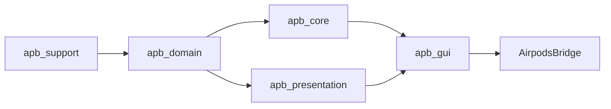
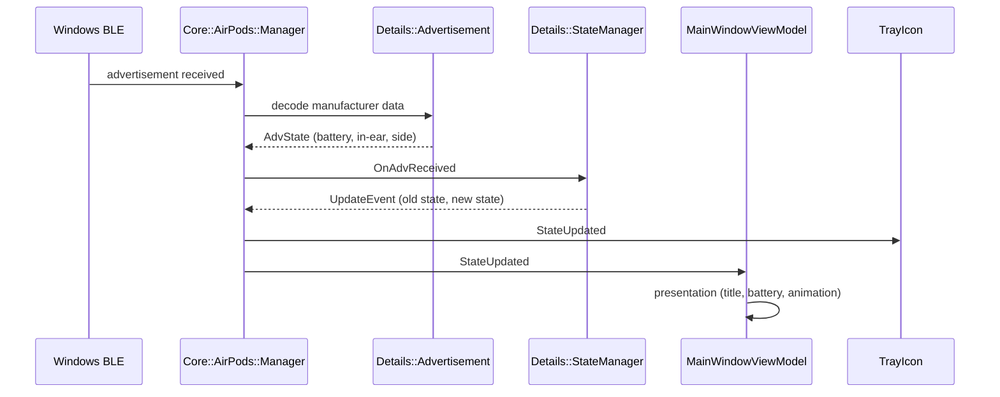

# Architecture

AirpodsBridge is a Qt 5 tray application for Windows. It reads the Bluetooth Low Energy
proximity-pairing advertisements that AirPods broadcast continuously, reconstructs the
device's battery and in-ear state from them, and surfaces that state in the notification
area.

This document describes how the code is arranged and which rules the arrangement enforces.

## Modules

The build defines five static libraries and one executable. Every directory under
`Source/` maps to exactly one of them, so the module a file belongs to is always visible
from its path.

| Directory | Target | Responsibility |
| --- | --- | --- |
| `Source/Support/` | `apb_support` | Logging, assertions, error types, launch options, and the Windows OS glue in `OS/`. No domain knowledge. |
| `Source/Domain/` | `apb_domain` | Advertisement decoding and device state. Pure logic: no widgets, no platform calls. |
| `Source/Core/` | `apb_core` | Services that talk to Windows: Bluetooth, global media, autostart, settings, updates. |
| `Source/Presentation/` | `apb_presentation` | View models, display types, and `Theme.h` -- the colour and metric tokens the widgets draw with. |
| `Source/Gui/` | `apb_gui` | Qt widgets and `.ui` forms. |
| `Source/App/` | `AirpodsBridge` | Entry point, application lifetime, wiring. |
| `Source/Resource/` | — | Icons, animations, the silent audio clip, Windows resource scripts. |

## Dependency direction

Dependencies point in one direction only.



CMake enforces the *link* graph through `target_link_libraries`, but nothing stops a header
in one module from `#include`-ing a header in another: a header-only crossing compiles and
links happily. That is exactly why includes are root-anchored — the module a file reaches
into is visible at the call site, so a reversed arrow is caught by reading, and by the grep
in CI, rather than by the linker.

Two consequences are worth stating explicitly:

* **`apb_domain` never calls the platform.** It is the layer that unit tests exercise
  directly, which is only possible while it stays free of Windows and Qt widget code.
* **`apb_presentation` does not link `apb_core`.** A view model that reaches for a
  Bluetooth handle or a settings object is in the wrong layer.

## Include convention

Internal headers are included root-anchored, from the repository root:

```cpp
#include "Source/Domain/AirPodsState.h"
#include "Source/Support/Logger.h"
```

This is deliberate. It makes the module a file crosses into visible at the call site, so a
layering mistake is apparent while reading the includes rather than only at link time. It
also keeps same-named headers in different modules unambiguous — `Source/Support/Utils.h`
and `Source/Gui/Utils.h` both exist.

Third-party and generated headers keep angle brackets (`<QObject>`, `<Config.h>`).

## How a battery reading reaches the tray



`Application` connects `Manager::StateUpdated` to the main window, the tray icon and the
taskbar status independently — the tray icon is not fed through the view model.

`Manager` is the only piece that touches the radio. `Advertisement` and `StateManager` are
plain classes that take values in and hand values back, which is why the decode path is
covered by `Tests/AirPodsDomainTests.cpp` without a Bluetooth adapter present.

`StateManager` exists because AirPods use random non-resolvable Bluetooth addresses for
privacy, so a device cannot be recognised by any stable property. It tracks the desired
device heuristically — by RSSI, timing, and the two sides agreeing — and discards state
when the signal is lost.

## Known wart

`Source/Domain/AirPodsAdvertisement.h` includes `Source/Core/Bluetooth.h` to borrow the
`AdvertisementWatcher::ReceivedData` value type. That is a domain header naming a core
header, against the direction above.

It links because `ReceivedData` is a plain data type declared in a header, with the watcher
itself implemented in `apb_core`. Nothing in `apb_domain` calls into the platform. Removing
the include means extracting the received-data type into its own header, which is a change
to the Bluetooth abstraction rather than a move, so it is recorded here instead of hidden.

## Platform code

Windows implementations use the `_win.cpp` and `_win.h` suffix and are selected by CMake,
not by `#ifdef` at the call site:

```
Source/Core/Bluetooth.h            - selects the platform header
Source/Core/Bluetooth_abstract.h   - the interface the platform implements
Source/Core/Bluetooth_win.h/.cpp   - the Windows implementation
```

`APB_OS_WIN` is defined for every internal target. A port is structurally possible, but
this repository does not maintain one.

## Where state is kept

| What | Where |
| --- | --- |
| Settings | `Source/Core/SettingsRepository` |
| Logs | `%LOCALAPPDATA%\AirpodsBridge\AirpodsBridge.log` |
| Settings storage | Registry, `HKCU\Software\AirpodsBridge\AirpodsBridge` (`QSettings`, user scope, native format) |
| Device binding | Settings, by Bluetooth address |

## Related documents

* [Building](Building.md) — toolchain, configure, build options.
* [Releasing](Releasing.md) — versioning, tagging, published artefacts.
* [Performance](Performance.md) — the idle-CPU constraint and what keeps it low.
