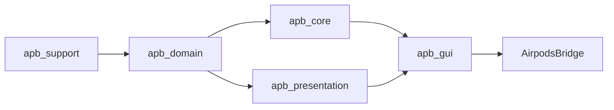
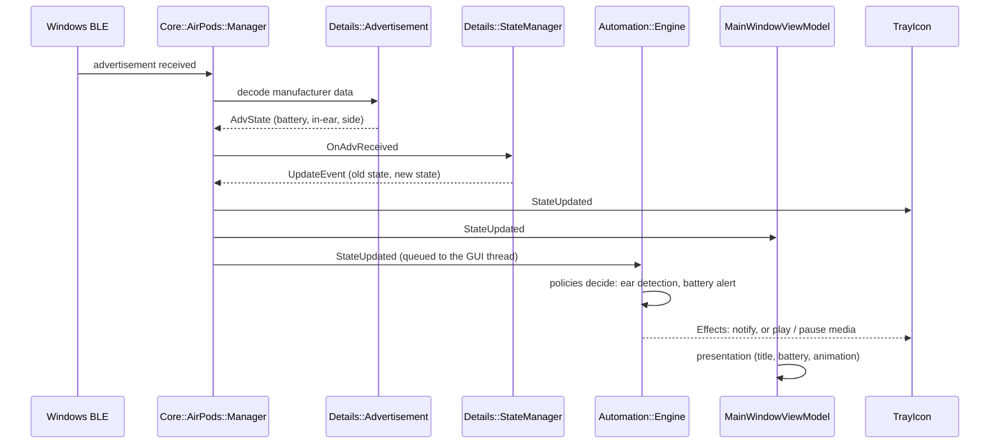

# Architecture

AirpodsBridge is a Qt 5 tray application for Windows. It reads the Bluetooth Low Energy
proximity-pairing advertisements that AirPods broadcast continuously, reconstructs the
device's battery and in-ear state from them, surfaces that state in the notification
area, and acts on it: pausing media, raising a notification, asking Windows to connect.

This document describes how the code is arranged and which rules the arrangement enforces.

## Modules

The build defines five static libraries and one executable. Every directory under
`Source/` maps to exactly one of them, so the module a file belongs to is always visible
from its path.

| Directory | Target | Responsibility |
| --- | --- | --- |
| `Source/Support/` | `apb_support` | Logging, assertions, error types, launch options, and the Windows OS glue in `OS/`. No domain knowledge. |
| `Source/Domain/` | `apb_domain` | Advertisement decoding, device state, and the automation policies — the decisions behind the Features page. Pure logic: no widgets, no platform calls. |
| `Source/Core/` | `apb_core` | Services that talk to Windows: Bluetooth, global media, autostart, settings, updates, quick connect, the system theme, the display's frame timing. And the automation engine, which feeds device events to the policies and carries their decisions out. |
| `Source/Presentation/` | `apb_presentation` | View models, display types, `Theme.h` -- the light and dark palettes, the metric and type tokens, and which palette the widgets are drawing with -- and `DeviceArtwork.h`, which resolves a device to Apple's picture of it. |
| `Source/Gui/` | `apb_gui` | Qt widgets, the painted controls in `Widget/`, the remaining `.ui` forms, and the frame clock their animations run on. |
| `Source/App/` | `AirpodsBridge` | Entry point, application lifetime, wiring. |
| `Source/Resource/` | — | Icons, fonts, the installer bitmaps, Windows resource scripts, and Apple's device artwork under `Device/` (generated, see [Artwork](Artwork.md)). |

## Dependency direction

Dependencies point in one direction only.



CMake enforces the *link* graph through `target_link_libraries`, but nothing stops a header
in one module from `#include`-ing a header in another: a header-only crossing compiles and
links happily. That is exactly why includes are root-anchored — the module a file reaches
into is visible at the call site, so a reversed arrow is caught by reading, and by the grep
in CI, rather than by the linker.

Two consequences are worth stating explicitly:

* **`apb_domain` never calls the platform.** It is the layer that unit tests exercise
  directly, which is only possible while it stays free of Windows and Qt widget code.
* **`apb_presentation` does not link `apb_core`.** A view model that reaches for a
  Bluetooth handle or a settings object is in the wrong layer.

## Three seams

The graph above is enforced by CMake and CI. Three seams inside it are conventions, and
they are what decide how much a new setting, a new behaviour, or later a driver costs.

### Settings are subscribed to, not observed

`Core::Settings` owns every setting the application has, as one line each in
`SETTINGS_FIELDS` (`Source/Core/Settings.h`): type, key, default, and the sentence the
settings window shows for it. Nothing in that file knows who reacts to a change. Whoever
does subscribes to one field, where the reaction lives:

```cpp
_settingsWatches.push_back(Watch(&Fields::pause_on_disconnect, [automation](bool enable) {
    automation->SetPauseOnDisconnect(enable);
}));
```

The callback runs once with the stored value when `Apply()` is called at startup, and after
that only when the value actually changes. It runs on the thread that changed the setting,
*after* the settings lock has been released, so it may read or modify settings itself; a
consumer on another thread hops over with a queued signal, as the `...Safely` signals in the
GUI classes do. Every subscription in the application lives in
`ApbApplication::WireSettings`, one per field, so that one function is the complete list of
what settings drive.

**To add a setting:** one line in `SETTINGS_FIELDS`, one `Watch` in `WireSettings`, one row
in `Gui::SettingsWindow` (a `BindToggle` / `BindSegments` / `BindValues` call). The store,
the log line, the description in the window and the test seam all follow from the first.

### Decisions are separate from effects

The Features page is a set of rules: pause when a bud comes out, alert when a battery is
low, connect when the case opens nearby. Each rule is a policy in
`Source/Domain/AutomationPolicies.h` — a class that takes device state and options in and
hands a decision back, with no side effects and no platform calls.
`Tests/AutomationTests.cpp` drives every one of them through its transitions without
AirPods in range, including the traps: the disconnected report every start produces, a
battery hovering around the threshold, a lid-open advertisement that repeats every second.

`Core::Automation::Engine` listens to the device manager, keeps the last state so a policy
can see the transition, and carries decisions out through `Core::Automation::Effects` —
four virtual methods: play, pause, notify, connect. `ApbApplication` implements them over
the real media controller, tray icon and quick connect; the tests implement them over a
recording fake. The engine lives on the GUI thread; the manager reports from its Bluetooth
thread, so the application connects the two with queued connections.

**To add a behaviour:** a policy in `AutomationPolicies`, its tests, a call in the engine,
and — only if the decision needs a new kind of effect — one more method on `Effects`.
`Core::AirPods::Manager` reports what the device does and decides nothing; it should not
need to change.

### The device manager reports; it does not decide

`Core::AirPods::Manager` is the only piece that touches the radio. It drives the BLE
watcher, follows the bound device's connection state, and feeds advertisements to
`Details::StateManager`. `Advertisement` and `StateManager` are plain classes that take
values in and hand values back, which is why the decode path is covered by
`Tests/AirPodsDomainTests.cpp` without a Bluetooth adapter present.

`StateManager` exists because AirPods use random non-resolvable Bluetooth addresses for
privacy, so a device cannot be recognised by any stable property. It tracks the desired
device heuristically — by RSSI, timing, and the two sides agreeing — and discards state
when the signal is lost.

The manager has one opt-in that spends idle CPU on purpose: scanning while the bound device
is disconnected (`SetScanWhileDisconnected`), so that its case opening nearby can be seen at
all. Advertisements seen in that mode never reach the state manager — the popup must not
light up for a device that is not connected — they only produce `LidOpenedNearby`, which
the engine turns into a connection request. See [Performance](Performance.md).

## How a battery reading reaches the tray



`Application` connects `Manager::StateUpdated` to the main window, the tray icon, the
taskbar status and the engine independently — the tray icon is not fed through the view
model, and the engine is not fed through the GUI.

## Include convention

Internal headers are included root-anchored, from the repository root:

```cpp
#include "Source/Domain/AirPodsState.h"
#include "Source/Support/Logger.h"
```

This is deliberate. It makes the module a file crosses into visible at the call site, so a
layering mistake is apparent while reading the includes rather than only at link time. It
also keeps same-named headers in different modules unambiguous — `Source/Support/Utils.h`
and `Source/Gui/Utils.h` both exist.

Third-party and generated headers keep angle brackets (`<QObject>`, `<Config.h>`).

## Known wart

`Source/Domain/AirPodsAdvertisement.h` includes `Source/Core/Bluetooth.h` to borrow the
`AdvertisementWatcher::ReceivedData` value type. That is a domain header naming a core
header, against the direction above.

It links because `ReceivedData` is a plain data type declared in a header, with the watcher
itself implemented in `apb_core`. Nothing in `apb_domain` calls into the platform. Removing
the include means extracting the received-data type into its own header, which is a change
to the Bluetooth abstraction rather than a move, so it is recorded here instead of hidden.

## Platform code

Windows implementations use the `_win.cpp` and `_win.h` suffix and are selected by CMake,
not by `#ifdef` at the call site:

```
Source/Core/Bluetooth.h            - selects the platform header
Source/Core/Bluetooth_abstract.h   - the interface the platform implements
Source/Core/Bluetooth_win.h/.cpp   - the Windows implementation
```

`APB_OS_WIN` is defined for every internal target. A port is structurally possible, but
this repository does not maintain one.

## Appearance

`Gui::Theme` (`Source/Presentation/Theme.h`) holds two palettes with the same tokens and
says which is in force; a widget reads `Theme::Colours()` when it paints and keeps nothing.
`Gui::ThemeController` (`Source/Gui/ThemeController.h`) is the one place the mode is
decided: it resolves the `appearance` setting against Windows' app mode, which
`Core::SystemTheme` reads from the registry and watches through the `WM_SETTINGCHANGE`
broadcast. On a change it swaps the palette, resets the application palette that Qt's own
widgets draw from, asks the compositor for matching title bars on every window, and sends
`Theme::ChangeEvent()` to every widget. The few widgets that have to bake a colour into a
stylesheet or a `QPalette` role -- `Widget::Label`, `Widget::ComboBox`,
`Widget::ScrollArea`, the About page's rich text -- redo that on the event; everything
else is simply repainted. The controller also fixes the widget style to Fusion before any
widget exists, because it is the one style in Qt 5 that draws entirely from its palette.

`Tests/ThemeTests.cpp` holds both palettes to WCAG contrast on every surface text lands on,
so a palette edit that loses readability fails there rather than in a screenshot.

**To add a colour:** one token in `Theme::Palette`, a value in each of the two palettes in
`Theme.cpp`, and a line in the test's token table. **To use one:** read it where it is
painted. A member initialised from `Theme::Colours()` is a bug: it stops following the
mode.

## Motion

Every animation is a `QVariantAnimation` or `QPropertyAnimation`, and all of them advance
from one clock: `Gui::FrameClock` (`Source/Gui/FrameClock.h`). Qt would otherwise tick
them from a plain timer at a fixed 60 Hz, whatever the display does. The clock installs a
`QAnimationDriver` -- the hook Qt Quick uses to sync QML to vsync -- so Qt asks it for time
instead. A worker thread waits on the display through `Core::DisplayTiming::FrameWaiter`
(`Source/Core/DisplayTiming.h`): the kernel graphics scheduler's vertical-blank wait for
the display's own adapter first, the compositor's flush if that is refused, a
high-resolution timer paced at the display's nominal rate if there is no compositor or a
source stalls. Each blank is posted to the GUI thread as one frame; a frame that lands
while the last is still being drawn merges into it rather than queueing. Which display is
followed is decided when a run of animation starts -- the active window's, else the one
under the pointer -- because the driver has no window of its own. The thread sleeps on a
condition variable while nothing moves.

The popup's device loop (`Widget::DeviceView`) is not a Qt animation; it holds the clock
directly and, on every frame, shows whichever of Apple's 60 fps frames is due by the time
elapsed. Durations still go through `Core::WindowEffects::AnimationDuration`, which rounds
them to whole frames of the display and collapses them to zero when Windows' animation
setting is off.

`Tests/FrameClockTests.cpp` checks that Qt's animations finish under the clock and that it
ticks while held and rests when let go. It cannot check that the ticks land on the blanks;
the clock's log line -- which display, what rate, which source -- is what to read for that.

## Where state is kept

| What | Where |
| --- | --- |
| Settings | `Source/Core/SettingsRepository` |
| Logs | `%LOCALAPPDATA%\AirpodsBridge\AirpodsBridge.log` |
| Settings storage | Registry, `HKCU\Software\AirpodsBridge\AirpodsBridge` (`QSettings`, user scope, native format) |
| Device binding | Settings, by Bluetooth address |
| Install location | Registry, `HKCU\Software\AirpodsBridge\Installer`, written by the installer and left alone by the application |

## Looking at the GUI

The settings window has no automated coverage — nothing can assert that a switch looks like
a switch. `Tests/SettingsPreview.cpp` builds it against an in-memory settings store and
renders every page to PNG, in light and then in dark (`-dark` suffix), without a tray icon,
a Bluetooth adapter or the registry:

```powershell
Build\dev\Binary\SettingsPreview.exe C:\some\folder
```

`PopupPreview.exe` does the same for the popup, once per model and mode. Look at the output
after any change to `Source/Gui/SettingsWindow.cpp`, the widgets, or a palette.

## Related documents

* [Building](Building.md) — toolchain, configure, build options.
* [Releasing](Releasing.md) — versioning, tagging, the installer, published artefacts.
* [Performance](Performance.md) — the idle-CPU constraint and what keeps it low.
* [Artwork](Artwork.md) — where the device pictures come from and how to refresh them.
