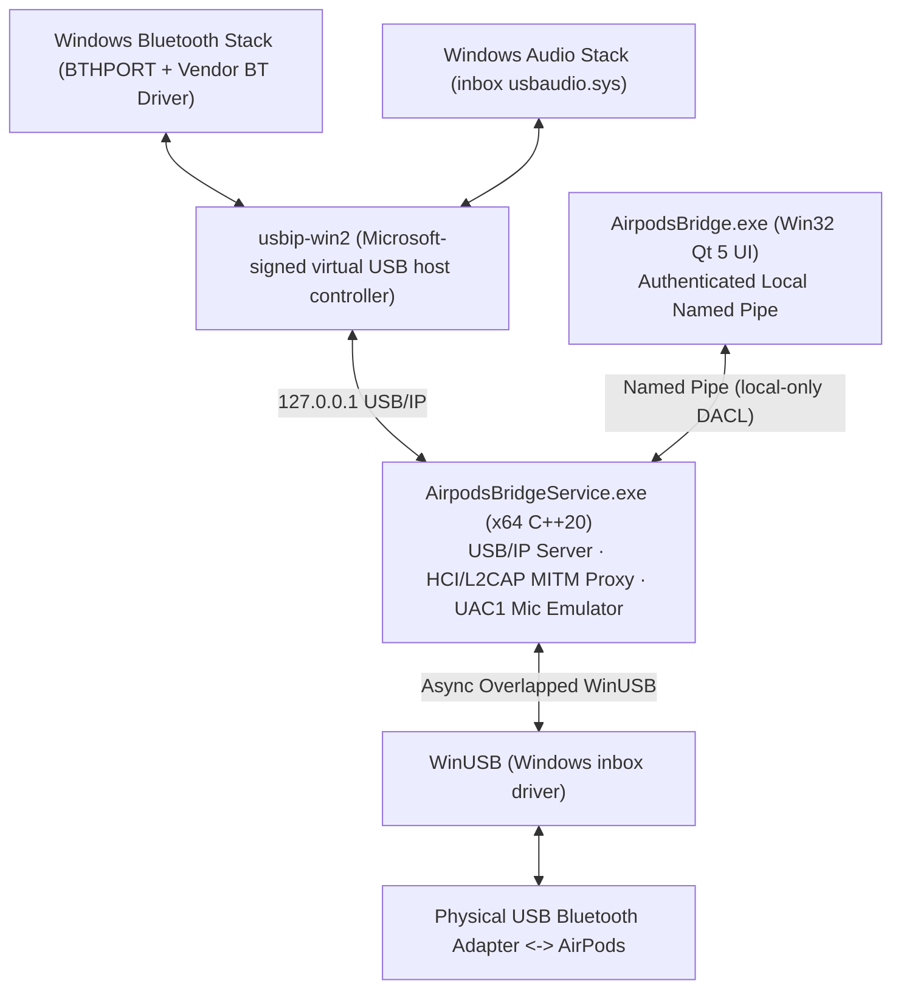

# No-Test-Mode Radio Proxy Service

AirpodsBridge can unlock full two-way Apple Accessory Protocol (AAP) controls — 1% battery
precision, Noise Cancellation / Transparency / Adaptive switching, Conversation Awareness,
Adaptive Audio level, One-Bud ANC, Personalized Volume, Loud Sound Reduction, Head
Gestures, Microphone Side, Tone Volume, Hearing Aid / Media Assist, HCI low-latency
polling, HCI Hands-Free protection, and a stereo-safe virtual USB microphone — **without
putting Windows into Test Mode and without disabling Secure Boot**.

## How it works

Windows does not expose Classic Bluetooth (BR/EDR) L2CAP sockets to user-mode
applications, which is what AirPods require for AAP (`PSM 0x1001`). Instead of shipping an
unsigned custom kernel driver, `AirpodsBridgeService.exe` (native x64 C++20, zero runtime
dependencies) composes three already-Microsoft-signed components around a user-mode
HCI/L2CAP man-in-the-middle engine:



1. **Pre-flight safety check:** Before touching any driver, the service verifies that
   Microsoft-signed `usbip-win2` (`usbip2_ude` + `usbip.exe`) is installed and locates a
   physical USB Bluetooth adapter (rejecting UART/SDIO radios and excluding its own
   virtual `usbip2_ude` instances).
2. **Inbox WinUSB binding (`RadioDriverManager`):** Switches the physical USB Bluetooth
   adapter (including composite `&MI_nn` functions such as MediaTek RZ616/MT7922) to
   Windows' inbox `WinUSB` driver (`%SystemRoot%\INF\winusb.inf`).
3. **Virtual adapter pass-through (`UsbIpServer` + `RadioBridgeSession`):** Exports the
   real hardware descriptors on `127.0.0.1` over USB/IP v1.1.1 so `usbip-win2` hands a
   virtual copy back to Windows' native Bluetooth stack (`BTHPORT`). Every Bluetooth
   device on the PC continues to pair, encrypt, and stream normally.
4. **Invisible AAP injection (`HciProxyEngine`):** Watches HCI events and ACL frames in
   user mode. Once Windows encrypts the ACL link to your AirPods, the engine opens an
   L2CAP channel on `PSM 0x1001` using reserved local CIDs (`0x7F40..0x7FFF`) and
   signaling IDs (`0xC0..0xFE`), intercepts all replies before Windows sees them, tracks
   Windows L2CAP fragmentation boundaries so injected frames never split a Windows PDU,
   and subtracts its own completed packets from `Number_Of_Completed_Packets` (`0x13`) so
   Windows' controller buffer accounting stays exact.
5. **Virtual stereo-safe microphone (`Uac1MicEmulator` + `MicBridgeSession`):** Optionally
   exports a second virtual USB Audio Class 1.0 (UAC1) 48 kHz mono 16-bit microphone over
   `usbip-win2` so Windows automatically binds inbox `usbaudio.sys`. Includes an adaptive
   clock-drift jitter buffer, fade-out Packet Loss Concealment (PLC), 60 Hz DC-blocking
   high-pass filter, and soft limiter.

## Architecture & process split

`AirpodsBridge.exe` is built as 32-bit Win32 to match Qt 5.15.2 `win32_msvc2019`. On
64-bit Windows, SetupAPI driver installation (`DiInstallDevice`) fails under WoW64 with
`ERROR_IN_WOW64`, and `usbip-win2` is native x64. Therefore:

- **`Service/Protocol/`** is a pure, platform-free C++20 static library (`UsbIpProtocol`,
  `HciProxyEngine`, `Uac1MicEmulator`, `WatchdogPolicy`, `ServiceProtocol`) compiled and
  unit-tested under both Win32 (`ctest --preset dev`) and x64.
- **`Service/Win/`** builds the standalone native x64 **`AirpodsBridgeService.exe`** with
  zero Qt, vcpkg, or .NET dependencies.
- **`Source/Core/AirPodsServiceTransport_win.cpp`** connects the Win32 UI app to the x64
  service over `\\.\pipe\AirpodsBridge.RadioService.v1` with `PIPE_REJECT_REMOTE_CLIENTS`
  and a local-only DACL, costing 0% idle CPU when the service is not installed or stopped.
- **`CompositeControlTransport`** automatically prefers the No-Test-Mode Radio Service,
  falls back to the optional `BthAapBridge` KMDF driver if present, and otherwise uses
  read-only BLE advertisements cleanly.

## Safety guarantees & rollback

- **Circuit-breaker watchdog (`WatchdogPolicy`):** 3 failed takeover attempts inside a
  rolling 10-minute window trip the safety guard, log an error to the Windows Event Log,
  automatically restore the native vendor Bluetooth driver, and stop retrying until you
  explicitly click **Retry engine** in `Settings -> AirPods control`.
- **Healthy session reset:** After 60 seconds of healthy operation, prior transient
  failures clear automatically.
- **Emergency one-command restore:**
  ```powershell
  .\Tools\Setup-RadioService.ps1 -RestoreOnly
  # or directly:
  .\Build\service-x64\Binary\AirpodsBridgeService.exe --restore-radio
  ```
- **Read-only pre-flight inspection (changes nothing):**
  ```powershell
  .\Build\service-x64\Binary\AirpodsBridgeService.exe --preflight
  ```

## Building & enabling

1. Build the x64 Radio Service:
   ```powershell
   cmake -S Service -B Build/service-x64 -G "Visual Studio 17 2022" -A x64
   cmake --build Build/service-x64 --config RelWithDebInfo
   ```
2. Install the latest signed `usbip-win2` x64 release from
   https://github.com/vadimgrn/usbip-win2/releases.
3. Run the elevated setup script (or click **Enable** in `Settings -> AirPods control`):
   ```powershell
   .\Tools\Setup-RadioService.ps1
   ```
4. To disable and return completely to your stock Windows Bluetooth driver:
   ```powershell
   .\Tools\Setup-RadioService.ps1 -Uninstall
   ```
