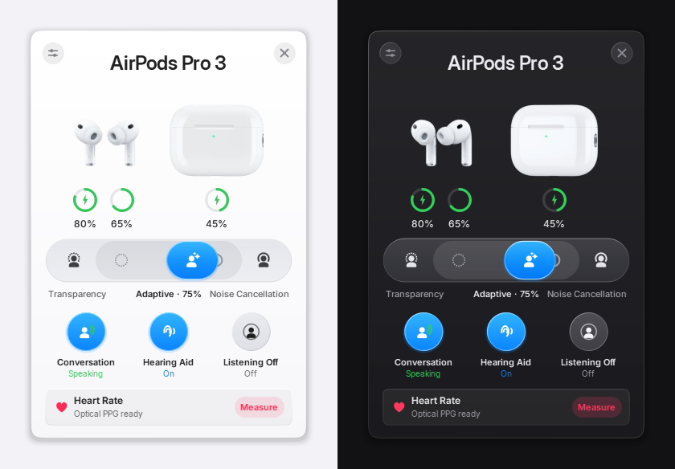
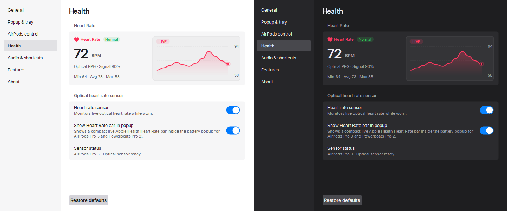
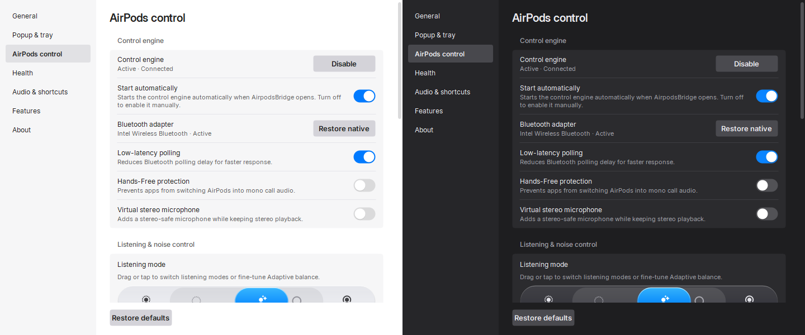

<div align="center">


# AirpodsBridge

**The native AirPods & Beats experience for Windows.**
Two-way noise control, optical heart rate, ultra-low-latency audio, and Liquid Glass UI — with Secure Boot on.

[](https://github.com/Arman2122/AirpodsBridge/actions/workflows/windows.yml)
[](https://github.com/Arman2122/AirpodsBridge/actions/workflows/lint.yml)
[](https://github.com/Arman2122/AirpodsBridge/releases)
[](LICENSE)
-0078D4.svg)


[Install](#install) · [Features](#features) · [Wiki](https://github.com/Arman2122/AirpodsBridge/wiki) · [Supported Devices](#supported-devices) · [CLI & Automation](#cli--automation) · [Build](#building-from-source)

</div>

---

Windows pairs with AirPods as generic Bluetooth headphones and leaves the best parts behind — no battery readout, no ear detection, no noise control, no heart rate telemetry, and unpredictable audio routing. **AirpodsBridge** brings those capabilities natively to Windows in a lightweight C++20 desktop application engineered around zero idle CPU.

- **Works out of the box (BLE mode):** Zero drivers, zero elevated permissions, and zero Apple account required. Reads Apple Continuity BLE broadcasts for battery levels, ear detection, media automation, nearby popups, and one-click connect while leaving standard Windows pairing untouched.
- **Unlocks full two-way hardware control (Control Engine):** An optional native 64-bit (`x64` / `ARM64`) Radio Proxy Service enables live Apple Accessory Protocol (AAP) controls — **without enabling Windows Test Mode and without disabling Secure Boot**.

<p align="center">
  
</p>

## Contents

- [Features](#features)
- [No-Test-Mode Control Engine](#no-test-mode-control-engine)
- [Requirements](#requirements)
- [Install](#install)
- [Usage](#usage)
- [CLI & Automation](#cli--automation)
- [Supported Devices](#supported-devices)
- [Building from Source](#building-from-source)
- [Documentation](#documentation)
- [Contributing](#contributing)
- [Language](#language)
- [Third-Party Components](#third-party-components)
- [Credits](#credits)
- [License](#license)

## Features

### Two-Way Listening & Noise Control

When the Control Engine is active, AirpodsBridge opens a direct AAP (`PSM 0x1001`) channel to your AirPods:

- **iOS Liquid Glass Listening Mode slider** — Switch between **Transparency**, **Adaptive Audio**, **Noise Cancellation**, and **Listening Off** by clicking or dragging. Inside Adaptive mode, the inner glass pill drags smoothly across the full `0–100%` noise-balance range.
- **Conversation Awareness with Windows media ducking** — Displays live speaking status and smoothly lowers Windows playback volume while you talk, restoring volume automatically when the conversation ends (while immediately yielding to manual volume changes).
- **Full Apple hardware controls** — **Hearing Aid** & **Media Assist**, **Personalized Volume**, **Loud Sound Reduction**, **One-Bud ANC**, **Allow "Off" listening mode**, **Microphone Side**, **Stem Press Speed & Hold Duration**, **Tone Volume**, **Head Gestures**, and exact **1% battery precision** for Left, Right, and Charging Case.

### Live Optical Heart Rate Monitoring

For optical PPG models (**AirPods Pro 3** and **Powerbeats Pro 2**), AirpodsBridge talks directly to Apple's RTBuddy sensor service (`opcode 0x17`):

- **Dedicated Health view** — Live tabular BPM, Heart Rate Zone indicator (`Resting`, `Normal`, `Elevated`, `Cardio`, `Peak`), optical PPG signal quality percentage, `Min · Avg · Max` session stats, and a cubic-Bezier live sparkline with automatic ear-removal pause to save battery.
- **Compact popup Heart Rate bar** — Optional one-click `Measure` / `Stop` bar inside the battery popup that jumps straight to **Settings → Health**.

<p align="center">
  
</p>

### Smart Audio Routing & Low-Latency Gaming

- **Instant Connect & automatic output switching** — Cached A2DP-first reconnection with automatic playback switching on connect or wear (`Switch audio on connect`, `Switch output when worn`), idempotent Windows audio-role routing, a `160 ms` silent A2DP wake pulse so audio starts reliably every time, and automatic restore to your speakers or headset on disconnect.
- **Hands-Free (HFP) protection** — Detects which application triggered muffled 16 kHz mono call audio (shown inline in the popup), locks Windows' default capture device to a chosen desktop microphone, optionally blocks AirPods HFP links at the Bluetooth HCI layer, or exposes a stereo-safe virtual USB microphone.
- **Ultra-low-latency audio suite** — Wear-aware `3.0 ms` `IAudioClient3` shared-mode A2DP keep-alive (down from Windows' `10.0 ms` default, released immediately when taken off), a native zero-PowerShell **`Music (AAC)` / `Gaming (SBC)`** switcher with live `IPolicyConfig` APO bypass (`Disable_SysFx`), and A2DP-safe `25.0 ms` HCI polling that keeps Apple H2 Left/Right inter-bud links synchronized cleanly.
- **Reconnect volume limiter** — Caps AirPods playback volume automatically on connect so audio never blasts unexpectedly.

### Everyday Automation & Native Polish

| Capability | Details |
| --- | --- |
| **Apple 3D artwork** | Genuine Apple renders and 60 fps loops across **all 31 AirPods & Beats models**, in native colourways where Apple publishes them. See [Artwork](Docs/Artwork.md). |
| **Nearby other-device popup** | Detects your AirPods nearby even while connected to an iPhone or iPad, showing live battery rings and a one-click **Connect** button. |
| **Automatic ear detection** | Pauses all active Windows media sessions on removal and optionally resumes on reinsertion, with single-bud mode and pause-on-disconnect protection. |
| **Battery intelligence** | Asymmetric drain / dirty charging-pin warnings, configurable low-battery alerts, optional 100% full-charge alerts, tray icon badge, and taskbar battery readout. |
| **Display-rate motion & themes** | `Gui::FrameClock` drives every animation at your display's exact refresh rate (60 Hz to 480 Hz) and ticks zero times while idle. Follows Windows Light/Dark mode live across every window, menu, taskbar widget, and title bar. |
| **Global shortcuts & IPC** | System-wide hotkeys for connect/disconnect, popup toggle, and Noise Control cycling, plus a local Named Pipe CLI for Stream Deck, AutoHotkey, PowerToys, and scripts. |
| **Zero-idle-CPU discipline** | Hardware-filtered passive BLE scanning, lazy timers, zero polling loops, and sleep/Modern Standby & `explorer.exe` recovery. See [Performance](Docs/Performance.md). |

## No-Test-Mode Control Engine

Windows does not expose Classic Bluetooth (BR/EDR) L2CAP sockets to user-mode apps, which AirPods require for two-way AAP (`PSM 0x1001`). Instead of shipping an unsigned custom kernel driver that forces Windows into Test Mode, **AirpodsBridgeService** (native `x64` / `ARM64` C++20, zero external runtimes) combines three Microsoft-signed building blocks:

1. **Windows inbox `WinUSB`** binds to your physical USB Bluetooth adapter.
2. **Microsoft-signed [`usbip-win2`](https://github.com/vadimgrn/usbip-win2)** presents a virtual copy of that adapter back to Windows' standard Bluetooth stack (`BTHPORT`), so pairing and all other Bluetooth devices keep working normally.
3. **`AirpodsBridgeService.exe`** bridges traffic over loopback (`127.0.0.1`), quietly multiplexing hidden AAP control frames onto your encrypted AirPods link with reserved controller ACL buffers, exact `Number_Of_Completed_Packets` credit accounting, and optional UAC1 virtual microphone emulation.

<p align="center">
  
</p>

> [!TIP]
> **Built-in rollback safety:** The service includes a circuit-breaker watchdog (3 consecutive takeover failures within 10 minutes automatically restore your native vendor Bluetooth driver), read-only `--preflight` hardware checks, and one-click **Restore native** inside **Settings → AirPods control** (or `AirpodsBridgeService.exe --restore-radio`). Full technical architecture is documented in [RadioService.md](Docs/RadioService.md).

## Requirements

| Mode | Requirements |
| --- | --- |
| **Standard (BLE)** | 64-bit Windows 10 (1809+) or Windows 11 (**x64** or **ARM64**), any Bluetooth Low Energy adapter, AirPods/Beats paired through standard Windows Bluetooth settings. |
| **Control Engine (Optional Two-Way AAP)** | 64-bit Windows 10/11 (**x64** or **ARM64**), a USB-attached Bluetooth adapter (covers virtually all Intel, MediaTek, Realtek, and desktop PCIe/USB Bluetooth cards; Snapdragon/ARM laptops with internal UART/SDIO Bluetooth work natively in BLE mode or with a USB Bluetooth adapter for Control Engine), and Microsoft-signed `usbip-win2` (`x64` or `arm64`, automatically downloaded and verified during in-app setup). Secure Boot stays **ON**. |

## Install

Download the latest release for your Windows architecture from the [GitHub Releases page](https://github.com/Arman2122/AirpodsBridge/releases).

| Asset | Architecture | When to use it |
| --- | :---: | --- |
| `AirpodsBridge-<version>-win-x64.exe` | **x64** (Intel / AMD) | Standard per-user installer (`%LOCALAPPDATA%\Programs\AirpodsBridge`) — no administrator prompt required to install or auto-update, replaces older 32-bit `v1.x` copies cleanly in place while keeping settings. |
| `AirpodsBridge-<version>-win-x64-portable.zip` | **x64** (Intel / AMD) | Unzip and run anywhere with no installer. Add an empty `portable` file (or `AirpodsBridge.ini`) beside `AirpodsBridge.exe` to store settings and logs in the same folder. |
| `AirpodsBridge-<version>-win-arm64.exe` | **ARM64** (Snapdragon / Windows on ARM) | Native ARM64 per-user installer — zero Prism emulation, native ARM64 Qt 6 UI and Radio Proxy Service. |
| `AirpodsBridge-<version>-win-arm64-portable.zip` | **ARM64** (Snapdragon / Windows on ARM) | Native ARM64 portable archive. |
| `SHA256SUMS.txt` | All | Cryptographic SHA-256 digests for verifying every download. |

Verify a download in PowerShell against `SHA256SUMS.txt`:

```powershell
Get-FileHash .\AirpodsBridge-<version>-win-x64.exe -Algorithm SHA256
```

> [!NOTE]
> Releases are unsigned unless code-signing secrets are configured for the repository, so Windows SmartScreen may warn the first time you run a new build. Verifying the SHA-256 digest against `SHA256SUMS.txt` is the reliable integrity check. See [Releasing](Docs/Releasing.md#code-signing).

## Usage

1. Pair your AirPods or Beats in **Windows Settings → Bluetooth & devices** as usual.
2. Launch **AirpodsBridge**. On first run, the welcome dialog lets you choose whether to enable the **Control Engine**, **Nearby Popup**, and **Launch at startup** (all reversible anytime in Settings).
3. Bind your device if prompted — AirPods rotate Bluetooth addresses, so AirpodsBridge tracks the specific paired device you choose.
4. Left-click the tray icon to open the Liquid Glass popup; right-click for quick actions, Connect/Disconnect, Noise Control, and Settings.

**Where files live**

- **Logs:** `%LOCALAPPDATA%\AirpodsBridge\AirpodsBridge.log` (rotating `5 MB × 2`). When filing a Bluetooth bug report, reproduce with `--trace` and attach this file.
- **Settings:** Stored per-user in `HKCU\Software\AirpodsBridge\AirpodsBridge` (or `AirpodsBridge.ini` beside the executable in portable mode). Uninstalling preserves your preferences.

## CLI & Automation

Running commands against a live AirpodsBridge instance communicates over a local per-user Named Pipe and returns structured JSON — ready for **Stream Deck**, **AutoHotkey**, **PowerToys**, or PowerShell scripts.

| Flag | Effect |
| --- | --- |
| `--status` | Print live device, battery, ear-detection, Noise Control, Heart Rate, and audio codec telemetry as JSON. |
| `--connect` | Connect the bound AirPods / Beats device. |
| `--disconnect` | Disconnect the bound device. |
| `--toggle-connect` | Toggle connection state. |
| `--popup` | Show or hide the battery & control popup. |
| `--settings` | Open the Settings window. |
| `--mode <value>` | Set Noise Control mode: `off`, `anc`, `transparency`, `adaptive`, or `cycle`. |
| `--trace` | Launch with trace-level logging enabled (for bug reports). |
| `--after-install` | Show the tray-ready welcome notification (passed by the installer). |
| `--help` | Print command-line options. |

Example:

```powershell
AirpodsBridge.exe --status
AirpodsBridge.exe --mode adaptive
AirpodsBridge.exe --mode cycle
```

## Supported Devices

AirpodsBridge recognises **31 Apple AirPods and Beats models** by Bluetooth PID, Apple Continuity payload, and AAP hardware model number (`0x1D`), bundled with official Apple artwork from `com.apple.MobileAsset.SharingDeviceAssets`.

| Lineup | Model | Noise Control (ANC / Transp.) | Adaptive & Conv. Awareness | Optical Heart Rate | Popup Artwork |
| --- | --- | :---: | :---: | :---: | --- |
| **AirPods** | AirPods 1 | — | — | — | 60 fps animated |
| | AirPods 2 | — | — | — | 60 fps animated |
| | AirPods 3 | — | — | — | 60 fps animated |
| | AirPods 4 | — | — | — | 60 fps animated |
| | AirPods 4 (ANC) | Yes | Yes | — | 60 fps animated |
| | AirPods 5 | Yes | Yes | — | 60 fps animated |
| | AirPods 5 (Wireless Case) | Yes | Yes | — | 60 fps animated |
| **AirPods Pro** | AirPods Pro | Yes | — | — | 60 fps animated |
| | AirPods Pro 2 | Yes | Yes | — | 60 fps animated |
| | AirPods Pro 2 (USB-C) | Yes | Yes | — | 60 fps animated |
| | AirPods Pro 3 | Yes | Yes | **Yes** | 60 fps animated |
| **AirPods Max** | AirPods Max | Yes | — | — | 60 fps animated, 5 colours |
| | AirPods Max (USB-C) | Yes | — | — | 60 fps animated, 5 colours |
| | AirPods Max 2 | Yes | Yes | — | 60 fps animated, 5 colours |
| **Powerbeats** | Powerbeats Pro 2 | Yes | Adaptive | **Yes** | 60 fps animated, 4 colours |
| | Powerbeats Pro | — | — | — | Official Apple render |
| | Powerbeats Fit | Yes | — | — | 60 fps animated, 14 colours |
| | Powerbeats (4) | — | — | — | Official Apple render |
| | Powerbeats 3 | — | — | — | Official Apple render |
| **Beats** | Beats Fit Pro | Yes | — | — | 60 fps animated, 14 colours |
| | Beats Studio Pro | Yes | — | — | Official Apple render |
| | Beats Studio3 | ANC | — | — | Official Apple render |
| | Beats Studio Buds | Yes | — | — | Official Apple render |
| | Beats Studio Buds + | Yes | — | — | Official Apple render |
| | Beats Solo Pro | Yes | — | — | Official Apple render |
| | Beats Solo 4 | — | — | — | Official Apple render |
| | Beats Solo3 | — | — | — | Official Apple render |
| | Beats Solo Buds | — | — | — | Official Apple render |
| | Beats Flex | — | — | — | Official Apple render |
| | BeatsX | — | — | — | Official Apple render |
| | Beats 360 | Yes | Adaptive | — | Official Apple render |

> [!NOTE]
> Battery and ear detection work across BLE and AAP; active Noise Control, Adaptive Audio, Hearing Aid, Conversation Awareness, and Heart Rate require the Control Engine (or an AAP L2CAP transport). Missing a newly released model? [Open an issue](https://github.com/Arman2122/AirpodsBridge/issues/new/choose) with a `--trace` log and its Bluetooth product ID.

## Building from Source

Requires **CMake 3.20+**, **Visual Studio 2022** (with `x64` MSVC toolset, plus `C++ ARM64 build tools` for ARM64 cross-compilation), **Qt 6.8.3 LTS** (`win64_msvc2022_64` and optionally `win64_msvc2022_arm64_cross_compiled`, both with `qtimageformats`), and a full **vcpkg** clone. With `VCPKG_ROOT` and `QT_ROOT_DIR` configured:

```powershell
# 1. Build and test the native x64 desktop application
cmake --preset dev
cmake --build --preset dev
ctest --preset dev

# 2. Build the native No-Test-Mode Radio Proxy Service (zero external runtimes)
cmake -S Service -B Build/service-x64 -G "Visual Studio 17 2022" -A x64
cmake --build Build/service-x64 --config RelWithDebInfo
```

Full setup instructions, presets, CMake options, and troubleshooting live in [Docs/Building.md](Docs/Building.md) and [Docs/RadioService.md](Docs/RadioService.md).

## Documentation

The [AirpodsBridge Wiki](https://github.com/Arman2122/AirpodsBridge/wiki) covers setup, compatibility, the Control Engine, and troubleshooting.

| Document | Contents |
| --- | --- |
| [Architecture](Docs/Architecture.md) | One-way module dependency graph, policy seams, and data flow from BLE/AAP to the UI. |
| [Radio Service](Docs/RadioService.md) | No-Test-Mode Control Engine design, USB/IP + HCI/L2CAP MITM architecture, and safety watchdog. |
| [Building](Docs/Building.md) | Toolchain setup, CMake presets, build options, and troubleshooting. |
| [Performance](Docs/Performance.md) | The zero-idle-CPU constraint, tray icon cache, and how to profile it. |
| [Artwork](Docs/Artwork.md) | How official Apple device renders and 60 fps HEVC-with-alpha loops are fetched and converted. |
| [Releasing](Docs/Releasing.md) | Versioning, tagging, NSIS installer packaging, portable ZIP, and Authenticode signing. |
| [Changelog](CHANGELOG.md) | Complete version history and release notes. |
| [Contributing](CONTRIBUTING.md) | Project scope, coding conventions, formatting, and pull request guidelines. |

## Contributing

Bug reports, new Apple/Beats device profiles, Windows Bluetooth/audio engineering, and performance improvements are welcome. Start with [CONTRIBUTING.md](CONTRIBUTING.md).

- [Report a bug, request a feature, or suggest a device](https://github.com/Arman2122/AirpodsBridge/issues/new/choose)
- [Ask a question or discuss an idea](https://github.com/Arman2122/AirpodsBridge/discussions)
- [Open a pull request](https://github.com/Arman2122/AirpodsBridge/compare)

## Language

AirpodsBridge is **English only** and contains no localisation framework. This is a deliberate scope constraint rather than a missing feature — pull requests adding translation catalogues will not be merged.

## Third-Party Components

| Component | License |
| --- | --- |
| [Qt 6.8.3 LTS](https://www.qt.io/download-qt-installer) | [LGPLv3](https://doc.qt.io/qt-6/lgpl.html) |
| [usbip-win2](https://github.com/vadimgrn/usbip-win2) *(optional runtime dependency for Control Engine)* | [GPL-3.0](https://github.com/vadimgrn/usbip-win2/blob/master/LICENSE) |
| [spdlog](https://github.com/gabime/spdlog) | [MIT](https://github.com/gabime/spdlog/blob/v1.x/LICENSE) |
| [cxxopts](https://github.com/jarro2783/cxxopts) | [MIT](https://github.com/jarro2783/cxxopts/blob/master/LICENSE) |
| [cpr](https://github.com/libcpr/cpr) | [MIT](https://github.com/libcpr/cpr/blob/master/LICENSE) |
| [nlohmann/json](https://github.com/nlohmann/json) | [MIT](https://github.com/nlohmann/json/blob/develop/LICENSE.MIT) |
| [SingleApplication](https://github.com/itay-grudev/SingleApplication) | [MIT](https://github.com/itay-grudev/SingleApplication/blob/master/LICENSE) |
| [magic_enum](https://github.com/Neargye/magic_enum) | [MIT](https://github.com/Neargye/magic_enum/blob/master/LICENSE) |
| [Boost.PFR](https://github.com/boostorg/pfr) | [BSL-1.0](https://github.com/boostorg/pfr/blob/develop/LICENSE_1_0.txt) |
| [Boost.Stacktrace](https://github.com/boostorg/stacktrace) | [BSL-1.0](https://www.boost.org/LICENSE_1_0.txt) |
| [Inter](https://rsms.me/inter/) | [SIL OFL 1.1](https://github.com/rsms/inter/blob/master/LICENSE.txt) |

## Credits

- [Discontinued Privacy: Personal Data Leaks in Apple Bluetooth-Low-Energy Continuity Protocols](https://hal.inria.fr/hal-02394619/document) — the protocol research behind Apple Continuity BLE advertisement decoding.

## License

Released under the [PolyForm Noncommercial License 1.0.0](LICENSE). You may use, modify, and share AirpodsBridge freely for any noncommercial purpose, including private personal use; commercial use is not licensed. All copies must carry the licence and its notice.

<sub>AirPods and Beats are trademarks of Apple Inc. AirpodsBridge is not affiliated with, authorized by, or endorsed by Apple Inc. Device artwork is Apple's; see [Artwork](Docs/Artwork.md#licence).</sub>
